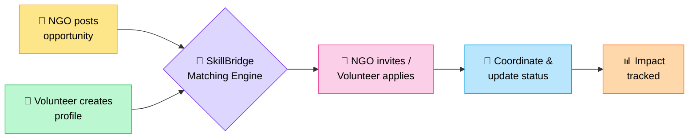

<div align="center">


<a href="https://git.io/typing-svg">
  
</a>

<br/>


</div>

---

## 🌟 About the Project

Bahut saare NGOs ko apne social initiatives ke liye **sahi skills wale volunteers** nahi milte, aur dusri taraf students aur professionals ko **suitable volunteering opportunities** dhundhna mushkil lagta hai.

**SkillBridge** is gap ko bridge karta hai — ek centralized platform jahan NGOs opportunities post kar sakte hain aur volunteers apni skills ke hisaab se projects find kar sakte hain.

> 🌍 **Theme:** *Collaboration for Social Good*

---

## 🎯 Problem Statement

| 😓 Problem | 💡 SkillBridge ka Solution |
|---|---|
| NGOs ko specific tasks ke liye volunteers nahi milte | 🤖 Skill-based smart matching |
| Volunteers ke paas ek central platform nahi hai | 📌 Ek jagah, saari opportunities |
| Manual coordination bahut time leta hai | 🤝 Application & invitation workflow |
| Contributions track karna mushkil hai | 📊 Impact dashboard |

---

## ✨ Key Features

<table>
<tr>
<td width="50%">

### 🤖 Smart Volunteer Matching
Skills, availability aur location ke basis par volunteers ko rank karta hai.

</td>
<td width="50%">

### 🏢 NGO Dashboard
Opportunities manage karo aur applications monitor karo.

</td>
</tr>
<tr>
<td>

### 🙋 Volunteer Profiles
Skills, experience aur availability ek profile mein.

</td>
<td>

### 📌 Opportunity Management
Community projects post aur manage karo.

</td>
</tr>
<tr>
<td>

### 🤝 Apply & Invite Workflow
NGOs invite karein ya volunteers khud apply karein.

</td>
<td>

### 📊 Impact Dashboard
Projects, tasks, applications aur contributions ke stats.

</td>
</tr>
<tr>
<td>

### 💾 Local Data Persistence
Prototype data browser ke localStorage mein save hota hai.

</td>
<td>

### 📱 Responsive Interface
Mobile se desktop tak har screen par smooth experience.

</td>
</tr>
</table>

---

## 📸 Screenshots

> 👉 Apne app ke screenshots `assets/` folder mein daalo aur neeche ke paths update karo.

<div align="center">

| 🏠 Home | 🏢 NGO Dashboard |
|:---:|:---:|
|  |  |

| 🙋 Volunteer Profile | 📊 Impact Dashboard |
|:---:|:---:|
|  |  |

</div>

---

## 🔄 How It Works



1. 🏢 **NGOs opportunities post karte hain** — description, required skills, location aur deadline ke saath.
2. 🙋 **Volunteers profile banate hain** — apni skills aur availability ke saath.
3. 🤖 **SkillBridge match karta hai** — compatibility criteria use karke.
4. 📩 **Invite ya Apply** — NGOs invite karte hain ya volunteers apply karte hain.
5. 🤝 **Coordination** — application aur task statuses update hote hain.
6. 📊 **Impact tracking** — progress aur contributions visualize hote hain.

---

## 🛠️ Tech Stack

<div align="center">

| Layer | Technology |
|:---:|:---:|
| 🎨 **Frontend** | React, TypeScript, HTML, CSS |
| ⚡ **Build Tool** | Vite |
| 💅 **Styling** | Tailwind CSS / Custom CSS |
| 🧠 **Matching System** | Skill-based compatibility scoring |
| 💾 **Data Storage** | Browser localStorage (no API keys needed) |
| 🛸 **Dev Environment** | Google Antigravity |

</div>

---

## 🚀 Getting Started

### 📋 Prerequisites
[Node.js](https://nodejs.org/) aur npm install hona chahiye.

### ⚙️ Installation

```bash
# 1️⃣ Repository clone karo
git clone https://github.com/YOUR-USERNAME/SkillBridge.git

# 2️⃣ Project folder mein jao
cd SkillBridge

# 3️⃣ Dependencies install karo
npm install

# 4️⃣ Dev server start karo
npm run dev
```

Phir terminal mein dikhne wala local URL browser mein open karo 🎉

---

## 🌱 Expected Impact

- ✅ Volunteering opportunities tak access aasan banana
- ✅ Suitable volunteers dhundhne ki mehnat kam karna
- ✅ Students aur professionals ko social initiatives mein judne ke liye prerit karna
- ✅ Community projects ka behtar coordination
- ✅ Volunteer contributions ko samajhna aur track karna

*Impact actual adoption par depend karta hai; prototype mein dikhne wale statistics sample data ho sakte hain.*

---

## 🔮 Future Enhancements

- [ ] 🔐 Firebase authentication aur cloud data storage
- [ ] 🔔 Applications aur invitations ke real-time notifications
- [ ] 🧠 Advanced volunteer recommendation algorithms
- [ ] ✅ Organization verification aur volunteer feedback
- [ ] 👥 Shared project workspaces aur team collaboration tools
- [ ] 🌐 NGOs aur volunteers ke liye multi-location deployment

---

## 👥 Target Users

| 🏛️ NGOs | 🎓 Student Volunteers | 💼 Skilled Professionals | 🏘️ Community Groups |
|:---:|:---:|:---:|:---:|
| Social organizations | College societies | Skill-based helpers | Local initiatives |

---

## 🏆 Project Vision

> *"To create a connected community where every skill finds an opportunity to make a difference."*

<div align="center">

### 💜 SkillBridge — Together, We Create Greater Impact.

*Developed as a hackathon prototype under the theme of **Collaboration for Social Good**.*


</div>
